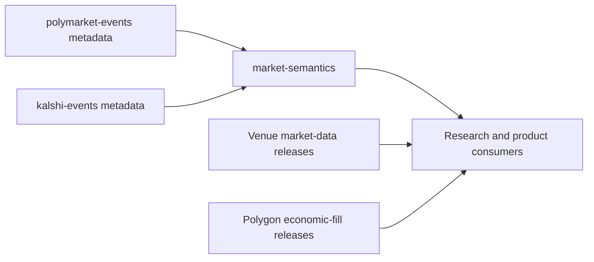

# Market Semantics Specification

Status: implemented, unreleased. Synthetic acceptance passes; real shared-claim
evidence remains a mandatory, currently blocked v1 readiness gate.

## Purpose

`TheOddsFox/market-semantics` gives Polymarket and Kalshi markets a common,
inspectable meaning. It compiles native definitions into canonical entities,
claims, and evidence-backed mappings so downstream consumers can determine what
contracts concern, how their outcomes relate, and whether their settlement
conditions are equivalent.

The first release supports binary election winner markets. It is a local,
operator-invoked batch application consuming immutable files and publishing
immutable files. It does not need a hosted graph database or service.

Hypertrial's `oddsfox-graph` remains a separately owned project and a reference
for compiler stages, validation, and provenance. This repository does not assume
its transfer, migration, runtime dependency, or WC2026 input format.

## Ownership and integration

| Repository | Owns | Relationship to Market Semantics |
| --- | --- | --- |
| `polymarket-events` | Native definitions, identities, observations, lifecycle, and metadata acquisition | Supplies a pinned metadata bundle. |
| `kalshi-events` | Native series, events, markets, rules, parents, and observations | Supplies a pinned metadata bundle. |
| `market-semantics` | Canonical entities and claims, semantic interpretation, outcome mappings, and relationship decisions | Publishes the shared semantic contract. |
| `polymarket-market-data` | Native prices, books, trades, and sampled OHLC | Its facts can be annotated downstream using typed native asset keys. |
| `kalshi-market-data` | Native candles, trades, and books | Its facts can be annotated downstream using market ticker and explicit side. |
| `polymarket-polygon-settlements` | Finalized exchange fills and economic legs | Optional later identity evidence or consumer of annotations; not required by the first release. |
| `website` and research applications | Presentation and application-specific analysis | Future consumers of approved semantic releases; no current website integration is required. |

Applications exchange verified copied releases. They do not share a warehouse,
mutable state, package imports, or a required checkout layout. Market Semantics
must never modify producer data or launch producer acquisition implicitly.
Initial integration requires no producer schema changes.

Polygon fills do not prove oracle resolution, redemption, which candidate won,
or settlement-policy equivalence. Native market-data repositories retain their
own fact grains and time semantics; this application does not rewrite them.

## First release scope

Support affirmative and negative outcomes of explicitly selected binary
contracts about a named candidate winning a specified election for an office.
The election must have a known jurisdiction, scheduled date or supported time
scope, and round. Distinct elections, offices, jurisdictions, rounds, and
candidates must remain distinguishable even when their display names match.

The first delivery targets the 2024 US presidential general election, initially
Donald Trump and Kamala Harris. Synthetic development may proceed before real
bundles are available, after the supported predicate, rule interpretations,
entity aliases and synthetic cases are frozen. Reviewed real records from both
venues establishing a shared candidate/election claim remain a mandatory v1
readiness gate. Integration into `main` does not satisfy that evidence gate or
authorize a v1 release. Selecting
election winner markets does not assert coverage of every election worldwide.

Supported interpretations use deterministic parsing and small, versioned curated
entity mappings. Explicit curated decisions may resolve an ambiguity when they
cite evidence. Unsupported or insufficiently evidenced records remain visible
with reasons. Unmapped is not the same as absent or unrelated.

Nomination and primary winners, popular-vote winners, vote margins, seat counts,
taking office, composite contracts, and multi-outcome winner contracts are
outside the initial family. A runoff is a distinct round; markets with
ambiguous runoff or contingent-election conditions remain unresolved. These
cases must not be coerced into the supported predicate.

The first release excludes acquisition, price normalization, probability
estimation, truth adjudication, profitability ranking, order execution,
automatic scheduling, a public API, a graph database, a generic rule language,
and a plugin framework. Local or remote LLM inference is not required.

## Input contracts

One compilation consumes one copied targeted bundle from each venue, with at
most 100 explicitly selected native markets per venue. Its scope is exactly
those selections, not either venue's complete inventory.

| Adapter | Required existing contract | Published JSON relations |
| --- | --- | --- |
| Polymarket | `oddsfox.polymarket.metadata.v1` | `markets`, `outcomes`, `memberships`, `identity_history`, `coverage` |
| Kalshi | `oddsfox.kalshi.metadata.v1` | `series`, `events`, `markets`, `coverage` |

Each relation has a `.json` filename; each bundle includes `manifest.json`.
Pin the contract, `source_release_id`, and SHA-256 of the exact manifest bytes.
The expected manifest digest must come from an operator-controlled selection
record outside the bundle, not a value supplied only by that bundle. Hashes
identify bytes; they do not authenticate a producer or establish factual truth.
Verify every declared file's literal name, size, hash, and required schema using
the producer's contract-specific rules. The producers' release-ID encodings
differ: Polymarket hashes its canonical inventory with a final newline; Kalshi
hashes compact sorted inventory JSON without that newline. Do not substitute
one generic release-ID calculation.

Only regular files inside the declared bundle are accepted. Reject traversal,
symlink escapes, unexpected contract versions, duplicate JSON object keys,
duplicate or conflicting usable current identities, and mismatched inventories.
The compiler must not follow source URLs, interpret source text as instructions,
or fetch missing definitions.

Polymarket exposes projected question, description, native identities, and
provenance. It does not provide all the event-title and sports fields expected
by the old Graph compiler, or guarantee complete settlement evidence. Its
`identity_history` is not historical rule text. Kalshi exposes richer native
definitions and authoritative parents, including rules in native payloads.
Both adapters must use the fields actually present rather than inventing a
uniform source record with unsupported values.

Coverage and identity usability are separate checks. Preserve each producer's
original coverage status and reason, and inspect market/outcome `usable` state.
A found record may still be unusable. Missing parents, failed acquisition,
source-confirmed absence, and unsupported semantics remain distinct. Do not
repair a record with fields from an older observation or stale bundle.
Producer-reported unusable records and conflicting or malformed historical
identity evidence remain diagnostic inputs. They must be accounted for in
coverage without nominating usable outcomes or accepted mappings; current-owner
uniqueness checks must not treat raw history as current identity nominations.

Full `oddsfox.polymarket.catalogue.v2` and `oddsfox.kalshi.catalogue.v1` releases
are possible future adapters, not first-release inputs. Their publication
formats and release identifiers must be verified separately before support is
declared; in particular, Polymarket catalogue uses `release_id` rather than
the targeted bundle's `source_release_id`.

## Semantic model

### Native outcomes

Native identity describes the contract being interpreted, not the real-world
claim it may share with another contract.

- Polymarket retains `venue`, `market_id`, `condition_id`, `source_market_version`,
  outcome ordinal and label, `asset_kind`, `asset_id`, and the supplied token or
  position identities. Equal IDs in different asset kinds remain distinct.
  Ordinals are one-based source positions, never inferred chain index sets.
- Kalshi retains native series/event/market tickers and an explicit YES or NO
  side. Declared parents must not be reconstructed from ticker prefixes.
- Labels and display order must never be used as native identity. An unknown
  identity cannot be made usable by generating a label-based ID.

Each native outcome revision is bound to its input manifest, selected source
observation, full native key, and a digest of the observed definition used for
interpretation. Preserve receipt time and source update time separately where
available. Polymarket's `source_market_version` describes source identity and
protocol selection; it is not a revision of semantic rules.

### Canonical entities and claims

Initial entity types are person, election, office, and jurisdiction. Canonical
entity IDs use stable curated keys; names and aliases are labels, not IDs. The
election record includes office, jurisdiction, date or explicit time scope, and
round, with evidence for the entity assignments.

A claim is a formal proposition with a predicate, canonical entity arguments,
explicit polarity, and any material scope needed for its truth conditions. The
initial predicate is `wins_election(candidate_id, election_id)`. YES and NO map
to positive and negative polarity only after checking their source definitions.
A title saying only "winner" is insufficient to choose the predicate.

Claim IDs derive deterministically from the versioned canonical representation,
including polarity and scope, never from titles or fuzzy similarity. A change
to material truth conditions creates a new claim ID. An alias or display-label
change must not change an entity or claim ID. Unknown scope cannot be treated
as a wildcard during matching.

Each native outcome may have at most one accepted atomic claim mapping in this
release. Multiple native outcomes can share a claim. Ambiguous interpretations
must remain unresolved rather than selecting the highest confidence candidate.

### Contract relationships

Sharing an entity or claim does not establish equivalent settlement. Evaluate
relationship decisions against pinned native outcome revisions, not just
canonical claim IDs.

| Relationship | Meaning |
| --- | --- |
| `related` | Contracts concern a shared election, candidate, or claim without an accepted equivalence assertion. |
| `equivalent` | The outcomes have the same supported claim and compatible normalized settlement payouts under all material documented conditions. |
| `inverse` | The supported outcomes have complementary claims and compatible settlement conditions whose normalized payouts are complementary. |

Every assessed pair has status `accepted`, `rejected`, or `unresolved`, evidence,
and a reason. A rejected equivalence is not proof that the markets are unrelated.
Only accepted rows assert a relationship. No row means no assessment, not a
negative conclusion. Candidate generation must be limited to the selected
elections and explicit supported rules; do not publish a Cartesian graph of all
market pairs.

Equivalence and inversion require known, compatible election identity, round,
candidate, winner criterion, deadlines and timezone, resolution sources,
certification/recount/dispute treatment, postponement/cancellation and withdrawal
exceptions, and payout behavior. Preserve structured policy fields with exact
source references; any material unparsed or missing rule yields unresolved
status. Known incompatible rules reject the proposed equivalence.

Certification, a media projection, popular-vote victory, and assuming office
must not be silently normalized to the same factual claim. NO on candidate A
does not imply YES on candidate B: other candidates and exception outcomes may
exist. Price, liquidity, title similarity, or an extraction confidence score
cannot establish settlement equivalence. Even accepted payout equivalence says
nothing about fees, execution, or the availability of a trading opportunity.

## Provenance and revision semantics

Every accepted entity assignment, claim mapping, and relationship must trace to
input contract, release and manifest hash, source observation and native key,
definition digest, source field or JSON pointer, and the interpreting rule or
curated-decision revision. Store sufficient quoted source evidence to explain a
decision without requiring the original producer warehouse.

Source receipt, provider update, trading close, election occurrence, resolution,
and semantic decision time are different concepts. The initial guarantee is
"as observed in these pinned inputs." Neither selected current records nor
identity history establish historical rule validity. Effective validity remains
unknown unless separately evidenced; never infer `valid_from` from receipt or
provider update time. Historical consumers must supply genuinely contemporaneous
snapshots and must not apply a current mapping to older facts by native ID alone.

Changed source definitions, entity assignments, or rules produce a new immutable
release and assessment revision. Record which prior assessment a correction
supersedes when supplied; retain previous releases and rejection reasons. A new
targeted selection or source absence must not delete global knowledge or retract
unselected markets. Conflicting curated decisions fail validation.

## Output contract

Publish `oddsfox.market-semantics.v1` as one self-contained release containing
the two verified input bundles, Parquet semantic relations, a JSON validation
report, and a checksummed manifest. Source evidence stays in release storage,
not in Git or installed packages. The relations below define required logical
grains; physical column types and canonical JSON encodings must be frozen with
schema fixtures before the first implementation release.

| Artifact | Required grain and content |
| --- | --- |
| `entities.parquet` | One row per canonical entity ID; type, label, aliases, scoped identity, and assignment evidence. |
| `claims.parquet` | One row per immutable claim ID; schema version, predicate, canonical arguments, polarity, scope, and canonical representation. |
| `native_outcomes.parquet` | One row per native outcome revision; complete typed native key, source observation, definition digest, settlement evidence, and usability. |
| `outcome_mappings.parquet` | One assessment per native outcome revision; accepted claim ID or null, status (`mapped`, `unresolved`, `unsupported`, `unusable`), reason, method, and evidence. Only `mapped` rows may have an accepted claim ID. |
| `relationships.parquet` | One assessment per canonical-ordered pair of native outcome revisions and relationship type; status, policy comparison, reason, and evidence. Equivalent and inverse pairs must not be duplicated in reverse order. |
| `coverage.parquet` | One row per requested venue/native market in the input selection; original producer status, source usability, outcome counts, semantic disposition, and diagnostics. |
| `validation_report.json` | Validation result, selected counts, all disposition/status counts, conflict counts, and unsupported or unresolved reasons. Mapping coverage and equivalence coverage must be reported separately. |

Accepted mappings reference existing usable native outcomes and existing claims;
claim arguments reference existing entities. Accepted equivalence requires
accepted mappings to the same claim. Accepted inversion requires explicitly
complementary claims and a complete compatible policy comparison. Counts must
reconcile to input selections and exported rows without duplicating memberships
or counting candidate decisions as accepted matches.

The manifest must declare contract and schema versions, release ID, compiler
revision, dependency lock digest, input contracts/releases/manifest digests,
rule and curation revisions, selection scope and limits, and each published
file's size, SHA-256, schema, and row count where applicable. Bundle inventories
must cover the included inputs as well as outputs. It must distinguish a
validated bounded selection from complete venue coverage.

Define the release ID as a digest of canonical input, compiler, rule/curation,
configuration, and output-inventory identities. Exclude the manifest itself,
absolute paths, and run timestamps to avoid self-reference and clock-dependent
identity. Lock the encoding in a fixture. Identical supported locked runtime,
inputs, rules, and decisions must produce identical semantic rows, IDs, sorted
artifact bytes, and release identity. Operational timestamps belong in logs.

## Compilation and verification

The CLI exposes two operations:

1. **Compile:** accept the two explicit input bundle paths, supported election
   selection and expected manifest digests, versioned rules/curation, resource
   limits, and a new output path. Copy inputs into bounded staging, verify the
   retained bytes against the pins, interpret supported records, assess
   relationships, validate all invariants, then atomically publish the immutable
   release.
2. **Verify:** accept a copied release and an independently pinned expected
   manifest digest; verify its contract, file inventory, schemas, identities,
   references, coverage accounting, provenance references, and accepted
   relationship invariants without networking or recompilation. These checks
   certify integrity and recorded invariants, not factual truth or the
   independent correctness of a curated interpretation.

Work occurs in a staging directory disjoint from producer roots and existing
releases. Refuse output overwrite and input/output overlap. Serialize writers
for the same destination. Interrupted, invalid, or limit-exhausted work must
not publish an invalid release or replace a previous release. Before the atomic
rename commit point, interruption leaves no completed destination. After that
point a valid release may exist without a success acknowledgement; verify it
instead of deleting or overwriting it. Retrying from
the pinned inputs is sufficient for the first release; no resume database is
required. No mutable `current.json` pointer is needed.

Enforce finite limits for input bytes, parsed records, candidate comparisons,
elapsed time, temporary storage, and output bytes. Validate inputs before
expensive comparisons. The first release is bounded to 100 selected markets per
venue; larger catalogue scans are a separate scope decision.

Corrupt inputs, incompatible schemas, malformed nominated native keys,
conflicting usable current identities or accepted decisions, broken references,
and failed validation fail compilation. Valid input that lacks semantic evidence
may publish an explicitly unresolved result. Producer-reported unusable records
and their diagnostic history do not by themselves fail compilation.
Coverage failures remain failures in the report, never absent or mapped;
successful compilation certifies its accounting, not successful source capture
or complete semantic coverage.

## Downstream consumption

Consumers obtain a semantic release's expected manifest digest from their
operator-controlled selection record and verify the release before use.
Joining outcomes to
prices requires Polymarket's full `(venue, asset_kind, asset_id)` key or Kalshi's
native market ticker and explicit side, plus the compatible source definition
revision. Native IDs alone do not establish a historical mapping's applicability.

Consumers select the appropriate market-data source/acquisition/capture and
native timestamp/revision policy before joining. They must not flatten multiple
captures into duplicate observations, sum overlapping coverage receipts, or
silently resample price histories here. A handoff fixture must demonstrate that
joining the selected mappings preserves the chosen fact grain.

No consumer may interpret shared claim IDs, `related` rows, unresolved decisions,
or confidence as accepted payout equivalence. Website serving, price comparison,
and private trading logic remain consumer responsibilities.

## Acceptance criteria

The first implementation is complete only when these checks pass offline:

1. Separately installed producer tools create representative synthetic bundles;
   compilation and verification run without sibling checkouts, producer database
   access, credentials, network calls, or a Graph installation.
2. The chosen real election/round has reviewed records from both venues that
   define the supported predicate and rule policy. At least one reviewed
   candidate/election pair maps to a shared claim across venues. If complete
   settlement-equivalence evidence is unavailable, that relationship remains
   unresolved and coverage reports the limit; do not manufacture a positive
   live equivalence assertion.
3. Positive synthetic fixtures map equivalent YES outcomes to one claim and
   accept compatible policy equivalence. Negative-polarity fixtures preserve
   explicit YES/NO orientation and test inversion without assuming two candidates.
4. Same-name candidates, different offices/jurisdictions/dates/rounds, primary
   versus general election, popular-vote versus election winner, taking office,
   and different certification/cancellation rules cannot become false equivalents.
5. Missing rule references, unknown round/timezone, ambiguous aliases, explicit
   nulls, unsupported composites, unusable identities, missing parents, absence,
   and failed source coverage have distinct visible outcomes.
   Producer-reported identity conflicts and malformed raw history remain visible
   without nominating usable assets or failing current-owner checks; conflicting
   usable current nominations do fail validation.
6. Polymarket CTF tokens and V2 positions remain distinct even for equal numeric
   IDs; both populated ID arrays, duplicate labels, ordinals, and multiple event
   memberships cannot change asset identity or multiply native outcome rows.
7. Reordering selection or processing, replaying identical pinned input bytes,
   and changing working directory preserve results. Re-encoding producer JSON
   changes input pins and provenance identities even if claims retain meaning.
   A source/rule correction creates a traceable new revision;
   a conflicting decision or incompatible version cannot silently replace it.
8. Producer-specific manifest encodings, corrupt/missing files, traversal,
   symlinks, malformed records, exhausted limits, interrupted writes, and
   concurrent publication leave prior releases intact and no completed bad release.
9. Verification detects tampered mappings, broken evidence references, invalid
   claim/entity links, incorrect counts, and unproven accepted relationships.
   Substituting files and recomputing internal hashes still fails against the
   externally pinned manifest digest.
10. A downstream synthetic price-fact fixture joins accepted mappings through
    the complete native key and compatible revision without row multiplication
    or loss of unmatched-fact visibility. Reusing a current definition for an
    unsupported historical interval is refused or explicitly unresolved.

## Delivery sequence

1. Freeze the election-family fixture, entity keys, schemas, policy checks,
   canonical encodings, and expected positive/negative decisions.
2. Implement the two offline metadata adapters, deterministic interpretation,
   curated mappings, validation, and immutable publication together.
3. Prove installed producer-to-consumer handoffs, release verification, failure
   recovery, and the downstream join fixture before broader domain coverage.

The implementation baseline is Python 3.12 with uv and versioned Parquet/JSON
contracts, matching the existing catalogue ecosystem. Choose the smallest
dependencies needed during implementation; importing the Graph package or its
local inference stack is not part of this scope. Scheduling, more elections,
catalogue adapters, generic graph exports, and LLM candidate generation require
separate evidence and acceptance criteria.

## Integration references

Existing contract baselines inspected for this specification:

- [Polymarket catalogue](https://github.com/TheOddsFox/polymarket-events/blob/10cfedce999e41fc63459b9054fb611b5b3f0297/README.md) and [current catalogue contract](https://github.com/TheOddsFox/polymarket-events/blob/10cfedce999e41fc63459b9054fb611b5b3f0297/docs/current-catalogue.md).
- [Kalshi metadata handoff](https://github.com/TheOddsFox/kalshi-events/blob/6fb46f7cf2bd6e9e5c3c750d71a68188f24e0872/README.md#targeted-metadata-handoff) and [native contract invariants](https://github.com/TheOddsFox/kalshi-events/blob/6fb46f7cf2bd6e9e5c3c750d71a68188f24e0872/docs/contracts.md).
- [Polymarket market-data contract and grains](https://github.com/TheOddsFox/polymarket-market-data/blob/fb2a3580352c1696e896dbbf08aea932b572e32d/README.md).
- [Kalshi market-data definitions and time semantics](https://github.com/TheOddsFox/kalshi-market-data/blob/39fdc2c6151861c47a1fb0d19c35c0529503e595/README.md).
- [Polygon economic-fill scope](https://github.com/TheOddsFox/polymarket-polygon-settlements/blob/fe019c5e1f128889a83ae4cd1867ffe7865553ac/README.md).
- [Website application boundary](https://github.com/hypertrial/oddsfox_website/blob/1d7794410cd73d5a8d4de4f29aafafdfab646f92/TECH_STACK.md).
- [Hypertrial Graph reference](https://github.com/hypertrial/oddsfox-graph/blob/88bb349169caf75ba2f78528582ac916ae243714/PRODUCT.md).
